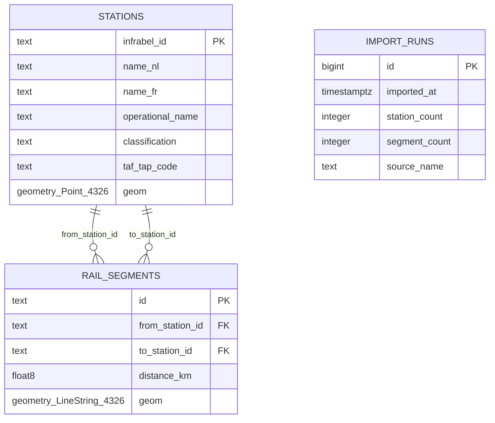

# Datamodel — versie 0.1

## Bronvelden en normalisatie

| Tabel/veld | Bron | Opmerkingen |
|---|---|---|
| `stations.infrabel_id` | Operationele punten: `ptcarid` | tekstwaarde, vormt ook FK in station_to_station |
| `stations.name_nl` | `commerciallongnamedutch` en fallbacks | commercieel waar beschikbaar |
| `stations.name_fr` | `commerciallongnamefrench` of operationele fallback | kan NULL zijn |
| `stations.operational_name` | `longnamedutch`/`shortnamedutch` | kan van commerciële benaming afwijken |
| `stations.classification` | `classification` | station, halte, andere operationele punten |
| `stations.taf_tap_code` | `taftapcode` | aanvullende standaard-ID; niet GTFS stop-ID |
| `stations.geom` | `geo_point_2d` (lon, lat in API 2.1) | `geometry(Point,4326)` |
| `rail_segments.from_station_id` | `stationfrom_id` | bron-ID |
| `rail_segments.to_station_id` | `stationto_id` | doel-ID |
| `rail_segments.distance_km` | `length` | Infrabel geschatte kilometerafstand |
| `rail_segments.geom` | `geo_shape.geometry` | GeoJSON LineString → PostGIS WGS84 |
| `rail_segments.id` | SHA256 van eindpunten/geometrie/afstand | stabiel voor identieke bronrecords |

De importer haalt beide datasets volledig op en doet een transactionele snapshotvervanging.
De routing behandelt fragmenten voorlopig als **ongerichte verbindingen**, met de opgegeven
Infrabel-afstand als gewicht. `networkx.shortest_simple_paths` berekent de top-k korte
kandidaatpaden. `via_id` concateneert twee kortste deelpaden. Fysieke kortste routes
verschillen van reizigersdienstregelingen en officiële tariefreiswegen.

## Vervolgmodel (nog niet geïmplementeerd)

- `gtfs_stops` + `station_identifier_mapping`: mapping PTCAR ↔ NMBS GTFS-stop-ID;
  nooit blind op naam koppelen.
- `gtfs_trips`, `stop_times`, `calendar`, `calendar_dates`: kalenderafhankelijke treinritten.
- `routing_restrictions`: eenrichtings-/exploitatie- en overstapbeperkingen waar mogelijk.
- `subscription_rules`: afzonderlijke, door officiële voorwaarden gestuurde module.
- `snapshots`/versiebeheer bij import in plaats van één actieve dataset.

## Datahygiëne en onzekerheid

- PTCAR-geometrie is een **representatief punt**, geen perronlocatie.
- `station_to_station` kan meerdere fysieke routes tussen twee aangrenzende stations tot één
  kortste fragment reduceren; dit model reconstrueert die alternatieven niet.
- De segmentafstand is geen berekende `ST_Length(geom::geography)` en ook geen tariefafstand.
- Een ontbrekend stationpunt krijgt desnoods het eerste/laatste lijnpunt als benadering.
- Stationnaam is niet uniek; de frontend en API werken met `infrabel_id`.
- In een geplande verbetering zou je naast de bestemming ook tussenstations kunnen afdwingen
  en per route een maximumbandbreedte in extra kilometers opgeven.
